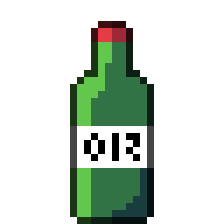
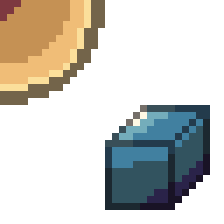
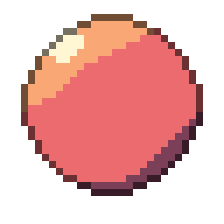
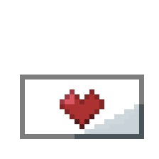
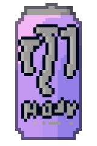
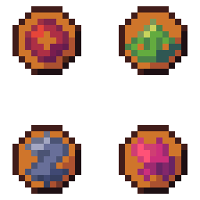
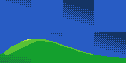
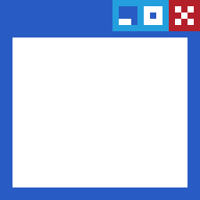
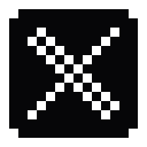

# 🎨 PixelArtJourney

Pixel arts quotidiens - Sprites créés avec [Aseprite](https://www.aseprite.org/).

**17 sprites • 6 jours • 43 frames au total**

Dernière mise à jour : 13 October 2026 à 14:55 UTC

---

## Jour 1 - slime

  
   
  <em>slime - 2 frames</em>

---

## Jour 2 - soju

  
   
  <em>soju - 1 frame</em>

---

## Jour 3 - cube, sphere

<table>
  <tr>
    <td align="center">
  
   
  <em>cube - 1 frame</em>
</td>
    <td align="center">
  
   
  <em>sphere - 1 frame</em>
</td>
  </tr>
</table>

---

## Jour 4 - loveletter, monsterviolet

<table>
  <tr>
    <td align="center">
  
   
  <em>loveletter - 1 frame</em>
</td>
    <td align="center">
  
   
  <em>monsterviolet - 1 frame</em>
</td>
  </tr>
</table>

---

## Jour 5 - liquide-bar, runic-bubble

<table>
  <tr>
    <td align="center">
  
   
  <em>liquide-bar - 26 frames</em>
</td>
    <td align="center">
  
   
  <em>runic-bubble - 1 frame</em>
</td>
  </tr>
</table>

---

## Jour 6 - background, discord-logo, github-logo, logo, separator, twitch-logo, windowsd, x-logo, youtube-logo

<table>
  <tr>
    <td align="center">
  
   
  <em>background - 1 frame</em>
</td>
    <td align="center">
  
   
  <em>discord-logo - 1 frame</em>
</td>
    <td align="center">
  
   
  <em>github-logo - 1 frame</em>
</td>
    <td align="center">
  
   
  <em>logo - 1 frame</em>
</td>
  </tr>
  <tr>
    <td align="center">
  
   
  <em>separator - 1 frame</em>
</td>
    <td align="center">
  
   
  <em>twitch-logo - 1 frame</em>
</td>
    <td align="center">
  
   
  <em>windowsd - 1 frame</em>
</td>
    <td align="center">
  
   
  <em>x-logo - 1 frame</em>
</td>
  </tr>
  <tr>
    <td align="center">
  
   
  <em>youtube-logo - 1 frame</em>
</td>
  </tr>
</table>

---

